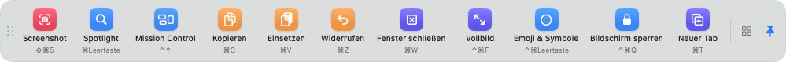
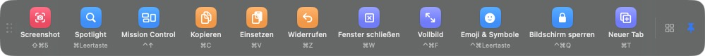
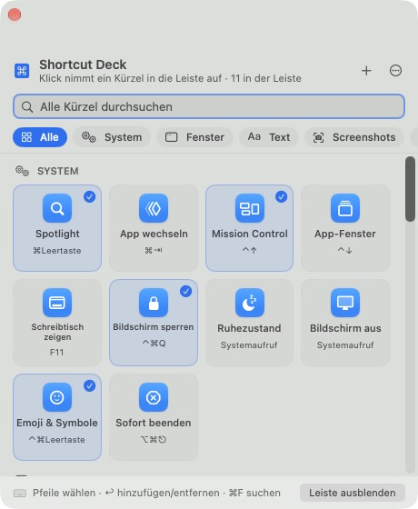
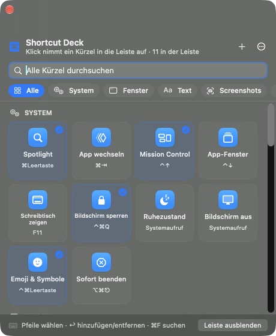

# Shortcut Deck

**Mac-Tastenkürzel als schwebende Leiste zum Anklicken.**
*A floating, Apple-style bar of macOS keyboard shortcuts you can click. Pick the shortcuts you need,
they stay visible, one click fires them in the app you were just using.*




## Was ist das?

Shortcut Deck ist eine kleine native macOS-App (SwiftUI, macOS 14 oder neuer). Sie zeigt eine
längliche Leiste – wie eine Navbar – mit den Tastenkürzeln, die du selbst auswählst: Screenshot,
Spotlight, Mission Control, App wechseln, Kopieren/Einsetzen, Vollbild, Fenster schließen, Bildschirm
sperren, Emoji-Auswahl, Finder-Befehle und eigene Kürzel. Jeder Eintrag zeigt ein SF-Symbol, den Namen
und das Kürzel klein darunter (⌘⇧4 usw.).

Ein Klick löst das Kürzel in der App aus, in der du gerade gearbeitet hast. Praktisch, wenn man sich
Kürzel nicht merken will, viel mit der Maus arbeitet oder Kürzel jemandem zeigen möchte.

| Zusammenstellen (hell) | Zusammenstellen (dunkel) |
|---|---|
|  |  |

## Funktionen

- **Eigene Auswahl:** Über das Raster-Symbol in der Leiste (oder das ⌘-Symbol in der Menüleiste) siehst
  du alle Kürzel nach Gruppen – System, Fenster, Text, Screenshots, Finder, Eigene – mit Suche.
  Ein Klick nimmt ein Kürzel in die Leiste auf (Haken) oder entfernt es.
- **Pin:** immer im Vordergrund, auch über Vollbild-Apps und auf allen Schreibtischen – oder als
  normales Fenster.
- **Verschieben:** am Punkte-Griff links oder an einer freien Stelle der Leiste ziehen. Die Position
  wird gemerkt, die Breite passt sich den Einträgen an.
- **Reihenfolge:** Einträge per Drag & Drop umsortieren oder per Rechtsklick (nach links/rechts,
  entfernen).
- **Eigene Kürzel:** Name, SF-Symbol und Kürzel einfach aufnehmen; Ziel wählbar (zuletzt aktive App,
  systemweit, Finder).
- **Kompakt:** Namen ausblenden, dann zeigt die Leiste nur Symbole.
- **Apple-Look:** native Materialien (Vibrancy), SF Symbols, Hell/Dunkel, Hover-Zustände,
  Tastaturbedienung im Auswahlfenster (Pfeile, ↩︎, ⌘F, ⎋).

## Installation

1. Unter [Releases](../../releases) `ShortcutDeck-1.0.dmg` laden, öffnen und **Shortcut Deck** auf
   **Programme** ziehen.
2. Die App ist nicht von Apple notarisiert (privates Projekt, nur lokal signiert). Beim ersten Start
   daher: Rechtsklick auf die App → **Öffnen** → **Öffnen**. Alternativ im Terminal:

   ```bash
   xattr -dr com.apple.quarantine "/Applications/Shortcut Deck.app"
   ```

3. **Bedienungshilfen erlauben:** Damit ein Klick Tastenkürzel an andere Apps senden darf, braucht die
   App die Freigabe unter *Systemeinstellungen → Datenschutz & Sicherheit → Bedienungshilfen*.
   Solange sie fehlt, zeigt die Leiste links ein oranges Hand-Symbol – ein Klick darauf stellt die
   Anfrage. Bildschirm sperren, Screenshot-Werkzeug, Mission Control und Ruhezustand gehen auch ohne.

Falls die Freigabe nach einem Update nicht greift:

```bash
tccutil reset Accessibility local.kimo.claude.ShortcutDeck
```

… dann auf das Hand-Symbol klicken und neu erlauben.

## Selbst bauen

Voraussetzung: Xcode 16 oder neuer.

```bash
git clone https://github.com/Majorkimo/shortcut-deck.git
cd shortcut-deck
./scripts/build-dmg.sh          # baut Release + build/ShortcutDeck-<version>.dmg
open build/Build/Products/Release/ShortcutDeck.app
```

Oder `ShortcutDeck.xcodeproj` in Xcode öffnen und starten.

## Wie ein Klick ausgelöst wird

1. Die App merkt sich laufend die zuletzt aktive andere App.
2. **Direkter Systemaufruf, wo es einen gibt:** Screenshot/Bildschirmaufnahme öffnen das
   Screenshot-Werkzeug (wie ⇧⌘5), Mission Control startet die Mission-Control-App, Bildschirm sperren
   nutzt dieselbe Funktion wie das Apple-Menü, Ruhezustand und Bildschirm aus nutzen `pmset`.
3. **Sonst per `CGEvent`:** Ziel-App nach vorne holen, warten bis sie aktiv ist, dann das Kürzel
   senden – systemweite Kürzel (Spotlight, ⌘⇥, ⇧⌘3/4, F11, ⌃↑/↓) über das HID-Event-Tap,
   Menübefehle (⌘C, ⌘W …) direkt an den Prozess der Ziel-App, Finder-Kürzel an den Finder.
4. **Tastaturlayout-sicher:** Buchstaben werden über das aktuelle Layout in Tastencodes übersetzt –
   auf einer deutschen QWERTZ-Tastatur bleibt ⌘Z „Widerrufen“ und wird nicht zu ⌘Y.

Die Leiste ist ein nicht-aktivierendes Panel: Ein Klick darauf nimmt der Arbeits-App den Fokus nicht
weg. Nach jedem Klick zeigt der Eintrag kurz ein grünes Häkchen (oder ein oranges Warnzeichen).

## Signatur

Die App ist ad hoc signiert, ohne Apple-Entwicklerkonto. `signing.req` setzt die Signatur-Anforderung
auf die Bundle-Kennung, damit die Bedienungshilfen-Freigabe Updates übersteht. Das ist für ein
privates Werkzeug bewusst so gewählt; für eine Verteilung im großen Stil wäre eine Developer-ID-Signatur
mit Notarisierung der richtige Weg.

## Aufbau

| Datei | Inhalt |
|---|---|
| `ShortcutDeckApp.swift` | App, `MenuBarExtra`, Start |
| `BarPanel.swift` | Leisten-Fenster: Pin, Position, Größe an Inhalt |
| `BarView.swift` | die Leiste, Einträge, Drag & Drop, Zieh-Griff |
| `LibraryController.swift`, `LibraryView.swift` | Zusammenstellen: alle Kürzel, Suche, Gruppen |
| `TileView.swift`, `EditorView.swift` | Kachel, Formular für eigene Kürzel |
| `Model.swift`, `Catalog.swift` | Kürzel-Modell, Tastaturlayout, eingebaute Kürzel |
| `Executor.swift` | Ziel-App fokussieren, CGEvent, Systemaufrufe, Bedienungshilfen |
| `Store.swift` | Leisten-Auswahl, eigene Kürzel, Einstellungen (UserDefaults) |

## Bekannte Grenzen

- Spotlight (⌘Leertaste) erscheint nur, wenn Spotlight auf dem Mac aktiv ist.
- Nur macOS 14 oder neuer.

## Lizenz

MIT – siehe [LICENSE](LICENSE).
